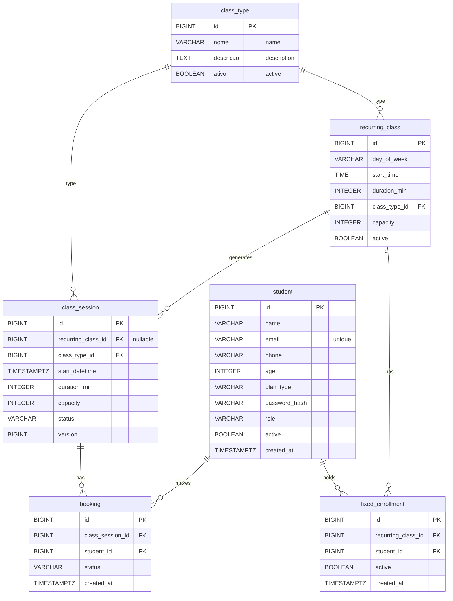

# Suryah Scheduling — Design

## Context

The existing codebase has four entities in Portuguese (`Aluno`, `Aula`, `Reserva`, `TipoAula`) with a V1 Flyway migration, JPA mappings, repositories, and a single read-only controller for class types. This design covers renaming everything to English, adding security, and building out the full scheduling feature set including recurring classes and fixed enrollments.

## Goals / Non-Goals

**Goals:**
- Rename all entities, tables, columns, enums, and packages to English.
- Add JWT authentication and role-based authorization (STUDENT / ADMIN).
- Build the full REST API for all 7 requirements.
- Keep the existing concurrency strategy (pessimistic lock) and extend it to the waitlist promotion flow.

**Non-Goals:**
- Frontend implementation (covered separately; this spec is backend-only).
- Email/SMS notifications (future iteration).
- Payment integration (TotalPass/Wellhub are just plan-type labels, not payment flows).
- Time-based cancellation cutoff (open cancellation for now; can be added later).

---

## Data Model

### Entity Relationship



### Renamed Entities (Portuguese → English)

| Current (PT)       | Renamed (EN)      | Table              |
|--------------------|-------------------|--------------------|
| `TipoAula`         | `ClassType`       | `class_type`       |
| `Aluno`            | `Student`         | `student`          |
| `Aula`             | `ClassSession`    | `class_session`    |
| `Reserva`          | `Booking`         | `booking`          |

### Renamed Enums

| Current (PT)         | Renamed (EN)      | Values                                              |
|----------------------|-------------------|-----------------------------------------------------|
| `Role`               | `Role`            | `ALUNO`→`STUDENT`, `ADMIN`→`ADMIN`                  |
| `TipoPlano`          | `PlanType`        | `PARTICULAR`→`PRIVATE`, `TOTALPASS`, `WELLHUB`      |
| `StatusAula`         | `ClassStatus`     | `ATIVA`→`ACTIVE`, `CANCELADA`→`CANCELLED`           |
| `StatusReserva`      | `BookingStatus`   | `CONFIRMADA`→`CONFIRMED`, `CANCELADA`→`CANCELLED`, `LISTA_ESPERA`→`WAITLIST` |

### Renamed Columns

**class_type (was tipo_aula):** `nome`→`name`, `descricao`→`description`, `ativo`→`active`

**student (was aluno):** `nome`→`name`, `telefone`→`phone`, `idade`→`age`, `tipo_plano`→`plan_type`, `senha_hash`→`password_hash`, `criado_em`→`created_at`

**class_session (was aula):** `tipo_aula_id`→`class_type_id`, `data_hora_inicio`→`start_datetime`, `duracao_min`→`duration_min`, `capacidade`→`capacity` + new nullable `recurring_class_id` FK

**booking (was reserva):** `aula_id`→`class_session_id`, `aluno_id`→`student_id`, `criado_em`→`created_at`

### New Entities

**RecurringClass** (`recurring_class`): the weekly slot definition that generates sessions.

| Column          | Type            | Notes                                            |
|-----------------|-----------------|--------------------------------------------------|
| `id`            | BIGSERIAL PK    |                                                  |
| `day_of_week`   | VARCHAR(10)     | `MONDAY`–`SUNDAY` (uses `java.time.DayOfWeek`)    |
| `start_time`    | TIME            | Local time of day the class starts               |
| `duration_min`  | INTEGER         | CHECK > 0                                        |
| `class_type_id` | BIGINT FK        | → `class_type(id)`                               |
| `capacity`      | INTEGER         | CHECK > 0                                        |
| `active`        | BOOLEAN         | Default `true`; false stops future generation     |

Unique constraint: `(day_of_week, start_time, class_type_id)` — prevents duplicate recurring slots.

**FixedEnrollment** (`fixed_enrollment`): a student permanently enrolled in a recurring class.

| Column              | Type         | Notes                                    |
|---------------------|--------------|------------------------------------------|
| `id`                | BIGSERIAL PK |                                          |
| `recurring_class_id`| BIGINT FK     | → `recurring_class(id)`                  |
| `student_id`        | BIGINT FK     | → `student(id)`                          |
| `active`            | BOOLEAN       | Default `true`                           |
| `created_at`        | TIMESTAMPTZ   | Default `NOW()`                          |

Unique constraint: `(recurring_class_id, student_id)` — one fixed enrollment per student per recurring class.

---

## Migration Strategy

Two new Flyway migrations on top of the existing V1.

### V2 — Rename to English

Renames all tables and columns from Portuguese to English. Updates CHECK constraints to use English enum values. Updates existing data rows (enum value strings). Recreates indexes with English names.

Key steps:
1. `ALTER TABLE ... RENAME TO ...` for all four tables.
2. `ALTER TABLE ... RENAME COLUMN ...` for every renamed column.
3. `DROP CONSTRAINT` + `ADD CONSTRAINT` for all CHECK constraints with new English enum values.
4. `UPDATE ... SET ...` to convert stored enum strings (`PARTICULAR`→`PRIVATE`, `ALUNO`→`STUDENT`, etc.).
5. Recreate indexes (`idx_aula_data`→`idx_class_session_start`, `idx_reserva_aluno`→`idx_booking_student`).

### V3 — Recurring Class & Fixed Enrollment

```sql
CREATE TABLE recurring_class (
    id             BIGSERIAL PRIMARY KEY,
    day_of_week    VARCHAR(10) NOT NULL CHECK (day_of_week IN
                   ('MONDAY','TUESDAY','WEDNESDAY','THURSDAY','FRIDAY','SATURDAY','SUNDAY')),
    start_time     TIME NOT NULL,
    duration_min   INTEGER NOT NULL CHECK (duration_min > 0),
    class_type_id  BIGINT NOT NULL REFERENCES class_type (id),
    capacity       INTEGER NOT NULL CHECK (capacity > 0),
    active         BOOLEAN NOT NULL DEFAULT TRUE,
    CONSTRAINT uq_recurring_class_slot UNIQUE (day_of_week, start_time, class_type_id)
);

CREATE TABLE fixed_enrollment (
    id                BIGSERIAL PRIMARY KEY,
    recurring_class_id BIGINT NOT NULL REFERENCES recurring_class (id),
    student_id        BIGINT NOT NULL REFERENCES student (id),
    active            BOOLEAN NOT NULL DEFAULT TRUE,
    created_at        TIMESTAMPTZ NOT NULL DEFAULT NOW(),
    CONSTRAINT uq_fixed_enrollment UNIQUE (recurring_class_id, student_id)
);

ALTER TABLE class_session ADD COLUMN recurring_class_id BIGINT REFERENCES recurring_class (id);
```

---

## API Design

All endpoints under `/api`. JSON request/response. DTOs are Java `record` types.

### Authentication (public)

| Method | Path                  | Body                          | Response                     |
|--------|-----------------------|-------------------------------|------------------------------|
| POST   | `/api/auth/register`  | `RegisterRequest`             | `StudentResponse`            |
| POST   | `/api/auth/login`     | `LoginRequest`                | `TokenResponse` (JWT)        |

### Class Types

| Method | Path                  | Role    | Description                    |
|--------|-----------------------|---------|--------------------------------|
| GET    | `/api/class-types`    | Any     | List active class types        |
| POST   | `/api/class-types`    | ADMIN   | Create class type              |
| PUT    | `/api/class-types/{id}` | ADMIN | Update class type              |
| DELETE | `/api/class-types/{id}` | ADMIN | Deactivate (soft delete)       |

### Recurring Classes (admin only)

| Method | Path                            | Description                              |
|--------|---------------------------------|------------------------------------------|
| GET    | `/api/recurring-classes`        | List all recurring classes               |
| POST   | `/api/recurring-classes`        | Create recurring class                   |
| PUT    | `/api/recurring-classes/{id}`   | Update recurring class                   |
| DELETE | `/api/recurring-classes/{id}`   | Deactivate (soft delete)                 |
| POST   | `/api/recurring-classes/generate` | Generate sessions for a date range     |

Request for generate: `{ "from": "2026-11-01", "to": "2026-11-30" }`
Response: summary of created sessions per recurring class.

### Class Sessions

| Method | Path                       | Role      | Description                                  |
|--------|----------------------------|-----------|----------------------------------------------|
| GET    | `/api/class-sessions`     | Authenticated | List upcoming sessions with availability. Query params: `from`, `to` (date range). |
| GET    | `/api/class-sessions/{id}`| Authenticated | Session detail with availability and caller's booking status. |
| PUT    | `/api/class-sessions/{id}`| ADMIN     | Edit session (override capacity, cancel).    |

Session response includes: `availableSpots` (capacity − confirmed bookings) and `myBookingStatus` (null / CONFIRMED / WAITLIST) for the logged-in student.

### Bookings

| Method | Path                                   | Role    | Description                          |
|--------|----------------------------------------|---------|--------------------------------------|
| POST   | `/api/class-sessions/{id}/bookings`   | STUDENT | Book a spot (or join waitlist).      |
| DELETE | `/api/bookings/{id}`                   | STUDENT | Cancel own booking.                  |
| GET    | `/api/bookings`                        | STUDENT | List own bookings (current + past). |

### Fixed Enrollments (admin only)

| Method | Path                                            | Description                      |
|--------|-------------------------------------------------|----------------------------------|
| GET    | `/api/recurring-classes/{id}/fixed-enrollments` | List fixed students for a class. |
| POST   | `/api/recurring-classes/{id}/fixed-enrollments` | Enroll a student as fixed.       |
| DELETE | `/api/fixed-enrollments/{id}`                    | Remove a fixed enrollment.       |

---

## Security Design

### Dependencies

- `spring-boot-starter-security`
- `jjwt-api`, `jjwt-impl`, `jjwt-jackson` (0.12.x) for JWT create/validate

### Flow

1. **Registration:** `POST /api/auth/register` → validate input → check email uniqueness → encode password with `BCryptPasswordEncoder` → save `Student` with `STUDENT` role → return student DTO (no password).
2. **Login:** `POST /api/auth/login` → authenticate email/password → generate JWT (subject = student ID, claim = role) → return token.
3. **Request auth:** `JwtAuthenticationFilter` intercepts every request, extracts Bearer token, validates signature + expiry, sets `Authentication` in `SecurityContextHolder` with role authority.
4. **Authorization:** `SecurityFilterChain` config — `/api/auth/**` is public, everything else requires authentication. Admin endpoints use `@PreAuthorize("hasRole('ADMIN')")`. Student-scoped endpoints resolve the logged-in student from the JWT subject.

### Admin Seeding

V3 migration inserts one admin user (email/password from environment variables) so the system is usable on first deploy. Password is BCrypt-hashed in the migration via a pre-computed hash.

---

## Concurrency Design

### Booking Flow (Requirement 1)

```
1. BEGIN TRANSACTION
2. SELECT ... FOR UPDATE on class_session (pessimistic lock)
3. Validate session status = ACTIVE
4. Check existing booking for (session, student) → reject if exists
5. Count CONFIRMED bookings for this session
6. IF confirmed < capacity → create booking with status CONFIRMED
   ELSE → create booking with status WAITLIST
7. COMMIT (releases lock)
```

### Cancellation Flow (Requirement 1)

```
1. BEGIN TRANSACTION
2. SELECT ... FOR UPDATE on class_session (pessimistic lock)
3. Find booking by ID, verify ownership (student) or admin
4. IF booking.status = CONFIRMED:
     SET status = CANCELLED
     Find oldest WAITLIST booking for this session (ORDER BY created_at LIMIT 1)
     IF exists → promote to CONFIRMED
   IF booking.status = WAITLIST:
     SET status = CANCELLED (no promotion needed)
5. COMMIT
```

The pessimistic lock on the class session row serializes all booking and cancellation operations for the same session, guaranteeing capacity is never exceeded and waitlist promotion is atomic.

---

## Session Generation Flow (Requirements 3, 4, 7)

When admin calls `POST /api/recurring-classes/generate` with a date range:

```
FOR each active RecurringClass:
  FOR each date in [from, to] matching recurringClass.dayOfWeek:
    start = combine(date, recurringClass.startTime) at studio timezone
    IF class_session already exists for (recurringClass.id, start):
      SKIP (idempotent)
    ELSE:
      CREATE class_session (type, duration, capacity from recurring class)
      FOR each active FixedEnrollment on this recurringClass:
        CREATE booking (status=CONFIRMED, student=fixedEnrollment.student)
      IF fixed enrollments > capacity:
        LOG WARNING (admin should increase capacity or remove enrollments)
        Only first `capacity` fixed enrollments get CONFIRMED, rest get WAITLIST
```

Idempotency check queries `class_session` by `recurring_class_id` and `start_datetime` so repeated generate calls don't duplicate sessions.

---

## Package Structure

```
br.com.suryah
├── SuryahApiApplication.java
├── auth/
│   ├── AuthController.java          # register + login endpoints
│   ├── AuthService.java             # registration, login validation
│   ├── JwtService.java              # token create/validate
│   ├── JwtAuthenticationFilter.java  # extracts + validates JWT per request
│   └── SecurityConfig.java          # SecurityFilterChain, PasswordEncoder
├── student/
│   ├── Student.java
│   ├── StudentRepository.java
│   ├── Role.java
│   └── PlanType.java
├── classtype/
│   ├── ClassType.java
│   ├── ClassTypeRepository.java
│   └── ClassTypeController.java
├── classsession/
│   ├── ClassSession.java
│   ├── ClassSessionRepository.java
│   ├── ClassStatus.java
│   └── ClassSessionController.java
├── recurringclass/
│   ├── RecurringClass.java
│   ├── RecurringClassRepository.java
│   └── RecurringClassController.java
├── booking/
│   ├── Booking.java
│   ├── BookingRepository.java
│   ├── BookingStatus.java
│   ├── BookingService.java          # booking + cancellation + waitlist logic
│   └── BookingController.java
├── fixedenrollment/
│   ├── FixedEnrollment.java
│   ├── FixedEnrollmentRepository.java
│   └── FixedEnrollmentController.java
└── common/
    ├── dto/                          # shared response/error DTOs
    └── exception/
        └── GlobalExceptionHandler.java
```

DTOs are Java `record` types, defined per feature package (e.g., `RegisterRequest`, `StudentResponse`, `ClassSessionResponse`).

---

## New Dependencies (pom.xml)

```xml
<dependency>
    <groupId>org.springframework.boot</groupId>
    <artifactId>spring-boot-starter-security</artifactId>
</dependency>
<dependency>
    <groupId>io.jsonwebtoken</groupId>
    <artifactId>jjwt-api</artifactId>
    <version>0.12.6</version>
</dependency>
<dependency>
    <groupId>io.jsonwebtoken</groupId>
    <artifactId>jjwt-impl</artifactId>
    <version>0.12.6</version>
    <scope>runtime</scope>
</dependency>
<dependency>
    <groupId>io.jsonwebtoken</groupId>
    <artifactId>jjwt-jackson</artifactId>
    <version>0.12.6</version>
    <scope>runtime</scope>
</dependency>
```

---

## Design Decisions (open questions resolved)

- **Cancellation cutoff:** No time-based restriction. Requirements don't specify one. Easy to add later as a configurable check in `BookingService`.
- **Waitlist limit:** Unlimited. Fine for a small studio. Can cap later if needed.
- **Fixed enrollment vs capacity:** Fixed enrollments count against capacity. If fixed enrollments exceed a session's capacity, the excess get WAITLIST status during generation. Admin should keep fixed enrollments ≤ capacity.
- **Admin user:** Seeded via V3 migration with credentials from environment variables (`ADMIN_EMAIL`, `ADMIN_PASSWORD_HASH`).
